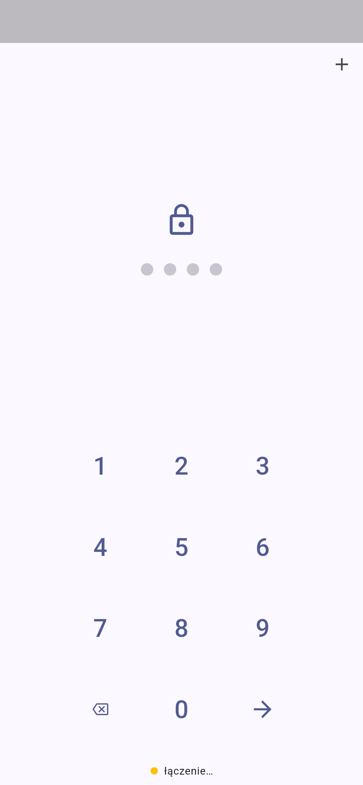
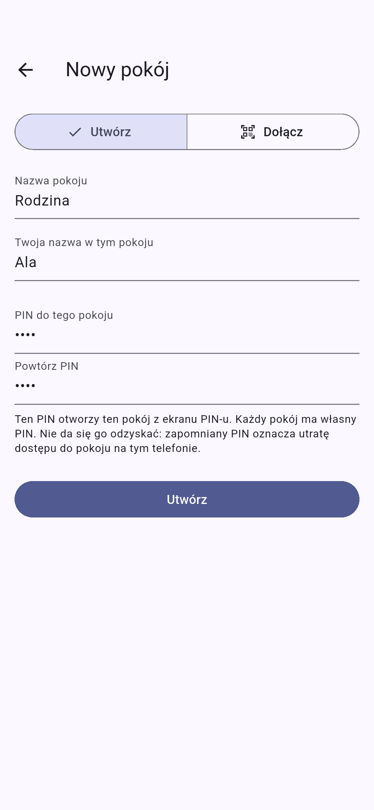
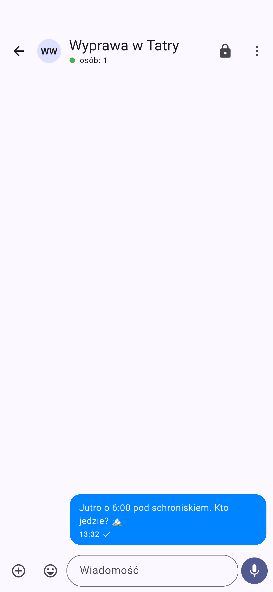
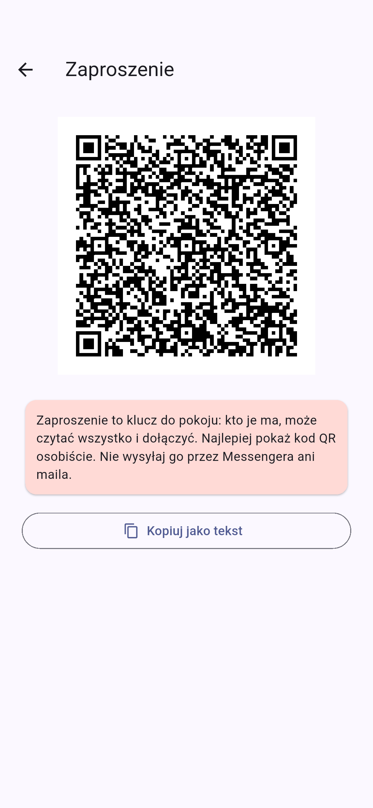

# p2p.communicator

A serverless messenger for text, photos, video and voice notes. Every phone
running the app is a full node of the [Veilid](https://veilid.com) network
(Rust, embedded in the app). Rooms are unlocked with a PIN: a single PIN pad,
where each PIN opens a different room and a wrong PIN opens nothing at all.

> Status: v0.1 skeleton. Passes `flutter analyze` and unit tests, and the
> Veilid core (`v0.5.8`) builds. Not yet tested on real phones (network,
> two devices).

**Download the APK:** [latest release](https://github.com/TBS093A/p2p.communicator/releases/latest)
(arm64, Android 7+). Android will ask you to allow installs from an unknown
source.

| PIN | New room | Chat | Invite |
|---|---|---|---|
|  |  |  |  |

Screenshots are taken by CI on an emulator (`integration_test/app_test.dart`)
and refreshed on the `screenshots` branch only when the UI changes.

## CI/CD (GitHub Actions)

| Workflow | When | What it does |
|---|---|---|
| [`premerge`](.github/workflows/premerge.yml) | every PR into `main` | format, `flutter analyze`, tests, debug APK, SAST + SCA, DAST (when app code changed) |
| [`postmerge`](.github/workflows/postmerge.yml) | every push to `main` | the same checks, then a signed release APK + GitHub Release, MobSF, DAST, screenshots |

### Security in the pipeline

| Type | Tool | What it checks | Blocking? |
|---|---|---|---|
| SAST | Semgrep (`p/default` + [`.semgrep/`](.semgrep/p2p-rules.yml)) | Dart, Kotlin, YAML, Actions; project rules: `Random()` in crypto code, logging secrets, `http://`, backup/cleartext in the manifest | yes |
| SAST | CodeQL (`actions`) | security of the workflows themselves (injection, permissions) | yes |
| SAST | Gitleaks | secrets in git history | yes |
| SCA | OSV-Scanner | vulnerabilities in `pubspec.lock` (blocking) and in Veilid's `Cargo.lock` (report only) | pub: yes |
| SCA | Dependabot | weekly update PRs for pub and Actions (7-day cooldown) | n/a |
| DAST | emulator + [`integration_test`](integration_test/app_test.dart) | the real app on the Veilid network: a wrong PIN opens nothing, each PIN opens only its own room, no crashes | yes |
| MAST | MobSF | analysis of the signed APK, PDF report attached to the release | report |

SAST and SCA results also show up under **Security → Code scanning**. All
actions are pinned to commit SHAs.

* Work on `feature/...` branches, open a PR into `main`, merge once
  `premerge` is green.
* Release version: `major.minor` from `pubspec.yaml` plus the run number as
  the patch (e.g. `v0.1.7`). To start `0.2.x`, change `version:` in
  `pubspec.yaml`.
* The APK is signed with the release key from the repo secrets
  (`ANDROID_KEYSTORE_BASE64`, `ANDROID_KEYSTORE_PASSWORD`, `ANDROID_KEY_ALIAS`,
  `ANDROID_KEY_PASSWORD`). Keep the original key outside the repo and back it
  up. Without the same key, new APKs cannot update an installed app.
* The first CI build compiles Veilid from source (slow); later builds use the
  cache.

## How it works

```
 Phone A                 Veilid network (DHT)                  Phone B
┌──────────┐   write    ┌──────────────────────┐   watch     ┌──────────┐
│ outbox A │──────────▶ │ encrypted records    │ ──────────▶ │ reads A  │
│ reads B  │ ◀───────── │ (stored by other     │ ◀────────── │ outbox B │
└──────────┘   watch    │  nodes, no content)  │   write     └──────────┘
                        └──────────────────────┘
```

* **A room** is a "roster" DHT record: the room name and the member list
  (subkeys 1..63). The roster writer key is part of the invite, so
  **the invite is the membership**.
* **Each member** has their own "outbox" record: subkey 0 is the message
  counter, subkeys 1..200 are a ring buffer of messages. Only the owner writes
  to it; the others watch it (`watchDHTValues`) and get notified of changes.
* **Media** is split into 32,000-byte chunks, 30 chunks per record (Veilid
  limits: 32 KiB per subkey, 1 MiB per record). A 20 MB video is about 21
  records. The record keys exist only inside the message, so only room
  members can find the files.
* **Encryption**: every DHT record has its own secret (Veilid encrypts the
  values), so the nodes storing data see only ciphertext. Locally, everything
  (messages, media, keys) is encrypted with the PIN-derived key.
* **Offline**: a message stays in the DHT, so the recipient fetches it after
  turning their phone on, even if the sender is offline by then. Anything you
  send without a connection is stored locally by Veilid and pushed once you
  are back online.

### PINs (`lib/vault/pin_vault.dart`)

* `master = Argon2(PIN ‖ pepper, salt)`. The **pepper** is 32 random bytes in
  the Android Keystore (`flutter_secure_storage`). A copy of the app's files
  alone is not enough to brute-force PINs offline.
* The slot file name is derived from `master`, so one PIN means one Argon2 run
  and a direct file read. There is no list of rooms anywhere.
* Slots have a fixed size and decoy slots sit next to the real ones, so the
  folder does not plainly reveal how many rooms exist. This makes it harder to
  tell, not impossible.
* After 5 failed attempts: a 30 s lockout, doubling up to 1 h.
* The app locks (back to the PIN pad) whenever it leaves the screen.
* Each room has its own identity (keys), so rooms cannot be linked to each
  other on the network.

## Layout

```
lib/
  core/veilid_node.dart     Veilid node startup, update stream, network status
  core/crypto.dart          AEAD / Argon2 / BLAKE3 via Veilid's crypto
  vault/pin_vault.dart      PIN → room, decoys, attempt limit, per-room data
  vault/room_secrets.dart   what a slot stores
  room/room_protocol.dart   record layout, creating and joining rooms
  room/room_session.dart    sync, sending, cache, media
  room/blob_store.dart      files in the DHT (chunks)
  room/invite.dart          invite (QR / text)
  room/message.dart         message model
  ui/                       PIN pad, new room, chat, invite, QR scanner
```

## Running it (Android)

Requirements: Flutter ≥ 3.47.1, Android SDK + NDK, and **rustup**. The
`veilid` package's build hook compiles the Rust core for Android. A system
`cargo` without rustup cannot add the Android targets.

```bash
rustup target add aarch64-linux-android armv7-linux-androideabi x86_64-linux-android
```

The `android/` folder (with permissions and signing config) is in the repo.
For local release signing, create `android/key.properties` (`storeFile`,
`storePassword`, `keyAlias`, `keyPassword`); it is git-ignored.

```bash
flutter pub get
```

```bash
flutter run
```

The first build compiles Veilid from source and takes several minutes or
more.

To try it: two phones (or a phone and an emulator). On the first, tap
"+ → Create", set a PIN, then "Invite". On the second, tap "+ → Join", scan
the QR code and set your own PIN.

## Known limitations (deliberate, planned)

* **Background**: Android puts the app to sleep. Without a foreground service,
  messages arrive only while the app is open. Planned for v0.2.
* **No push**: without Google's servers nothing wakes the phone. A message
  waits in the DHT until the app is opened.
* **200-message buffer per person**: if you were offline for more than 200
  messages from someone, their older ones can no longer be fetched.
* **DHT durability**: records live as long as the network stores and refreshes
  them. Old media may eventually disappear from the network; local copies
  remain.
* **Video** is sent without re-encoding (25 MB, 2 min limit). Transfers over
  the DHT are slower than through a server.
* **The invite** is the key to the room. There is no member removal or key
  rotation yet (the workaround is to create a new room).
* Veilid is at 0.x and its API changes. The dependency is pinned to tag
  `v0.5.8`.

## Roadmap

1. v0.1: first build, test on two phones, API fixes
2. v0.2: foreground service (node runs in the background) and local
   notifications
3. v0.3: video thumbnails, video compression, retrying failed sends
4. v0.4: audio/video calls (WebRTC, signalling over Veilid `appMessage`)
