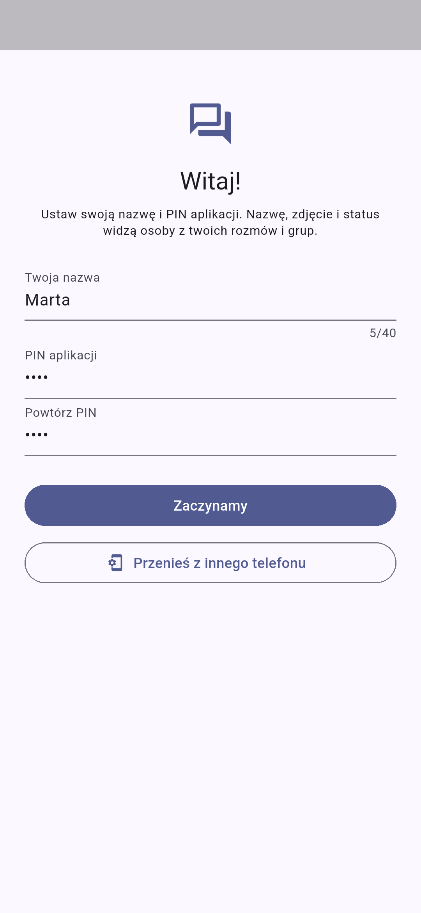
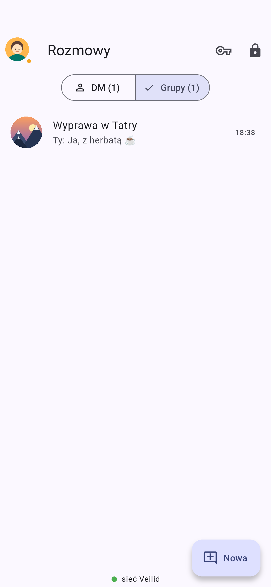
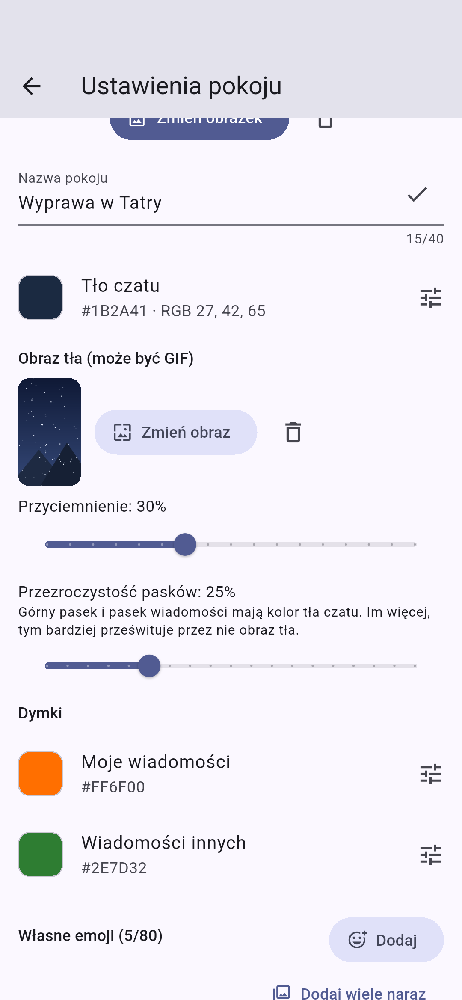
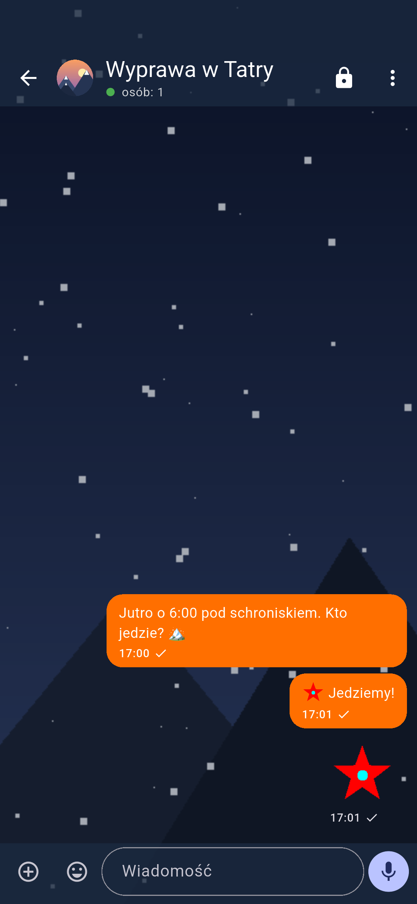
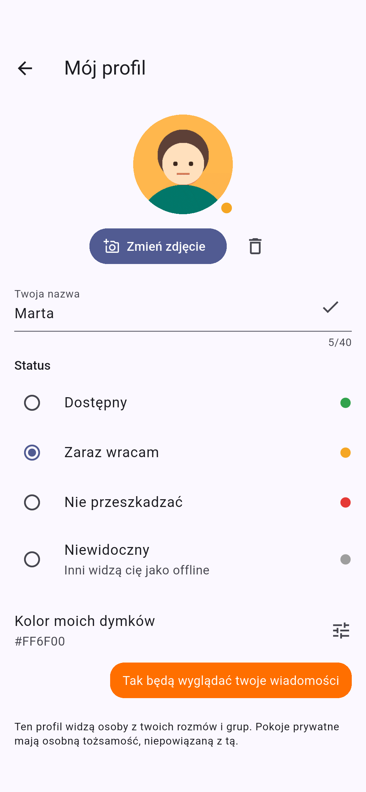
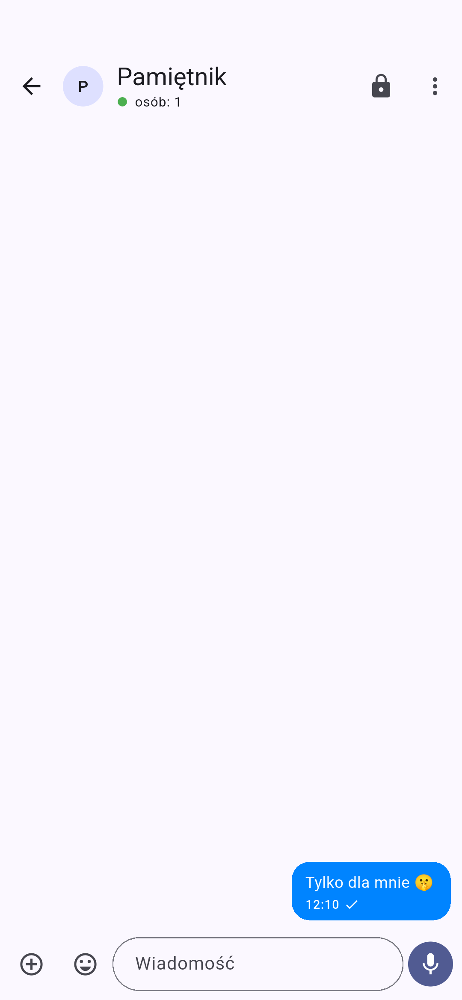
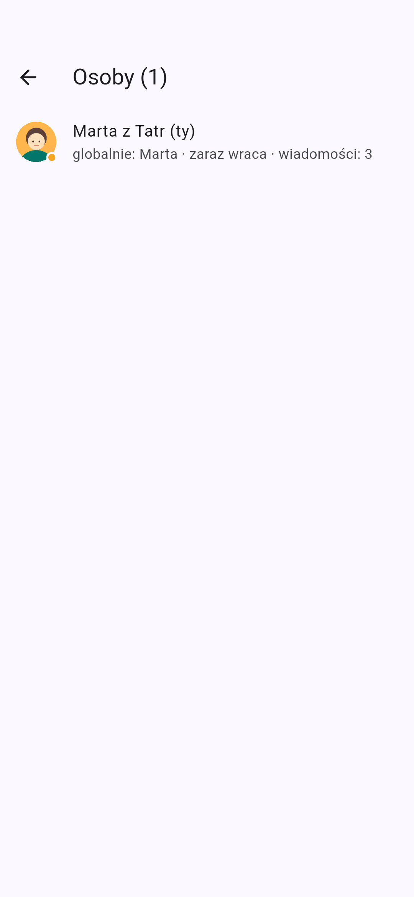
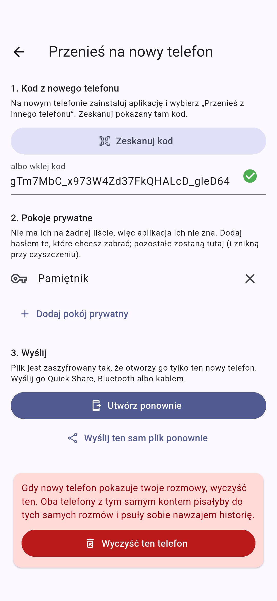

# p2p.communicator

A serverless messenger for text, photos, video and voice notes. Every phone
running the app is a full node of the [Veilid](https://veilid.com) network
(Rust, embedded in the app). The app opens with an **app PIN** and lists your
**DMs and groups**, with everyone's **online status** at the top. **Private
rooms** are separate: never listed, each one opens only with its own
**password** in private mode.

> Status: early (v0.x). Runs on real phones; automated tests run the app on
> an Android emulator against the live Veilid network on every PR.

**Download the APK:** [latest release](https://github.com/TBS093A/p2p.communicator/releases/latest)
(arm64, Android 7+). Android will ask you to allow installs from an unknown
source.

| First run | DMs and groups | Chat | Invite |
|---|---|---|---|
|  |  |  |  |

| Room settings (picture, background, GIF emoji) | Chat: GIF background, bubble color, GIF emoji | Profile and status | Private room |
|---|---|---|---|
|  |  |  |  |

| Members | Moving to a new phone |
|---|---|
|  |  |

## DMs, groups and private rooms

| | DM / group (public) | Private room |
|---|---|---|
| Listed on the home screen | yes (DM \| Grupy) | **never** |
| Opens with | the app PIN | **its own password** (private mode, key icon) |
| Your identity | one **global profile**: nickname, picture (GIF ok), status; optionally **a different nickname per DM/group** | a separate nickname per room, **unlinkable** to your profile |
| Status / presence | yes | no |

* **Statuses**: available, away, do not disturb, invisible. The app writes a
  heartbeat to your profile record every 60 s; no heartbeat for 3 min (or
  invisible) shows as offline.
* **Starting a DM**: by QR/text invite, or by tapping someone in the user
  bar (anyone you share a group with). The invite is **sealed to their
  identity key** (HPKE) and dropped into the shared group as a hidden
  message: every member tries to open it, only the addressee can, and nobody
  else learns who invited whom. They get an *accept / decline* prompt.
* **Nicknames**: your global nickname is used everywhere by default. In any
  DM or group you can set another one for that conversation only (*Mój
  profil* opened from the chat); picture and status stay global. It travels
  in your outbox head (`nick`), and the members list shows the global name
  behind it. Each private room has its own nickname anyway.
* Rooms from the old PIN-only version are now private rooms: open them in
  private mode with the old PIN as the password.

Screenshots are taken by CI on an emulator (`integration_test/app_test.dart`)
and refreshed on the `screenshots` branch only when the UI changes.

## Customization

Rooms are customizable, Discord-style, and every member sees the same thing:

* **Room look** (shared, any member can change it, in DMs too): an
  **uploaded room picture** (GIF allowed), the name, the **chat
  background**: any RGB color (sliders or HEX) and/or a **picture or
  animated GIF** with adjustable dimming.
* **Bubble colors per room**: one color for **your messages** and one for
  **everyone else's** (text, photos, video and voice notes). Defaults: blue
  `#0084FF` for yours, grey for others.
* **See-through bars**: the background picture runs under the top bar and
  the message bar, which are tinted with the room's background color at an
  adjustable transparency (25% by default), so the picture shows through
  while the bars stay distinct.
* **Sender avatars**, Telegram style: one avatar per run of messages from
  the same person, sticking to the bottom of that run while you scroll.
* **Custom emoji pack** of up to 80 images, added **one by one or in bulk**
  (codes are suggested from the file names). Animated **GIF/WebP emoji**
  play inline; type `:code:` or pick from the emoji button. A message of only
  1–3 emoji is shown large.
* **Automatic shrinking**: emoji over 512 KB are scaled down (and their
  frame rate thinned, for GIFs) until they fit, instead of being refused.
  Animated avatars (1 MB) and backgrounds (4 MB) work the same way; GIFs
  within the limit are stored byte for byte. Static photos are scaled down
  on the phone first, so a 12 MP photo costs tens of KB on the network.
* **Members list** with avatars and statuses.
* **App theme** (this phone only): system, light or dark.

Where it lives: the room look in roster subkey 0, your profile in the head of
your own outbox, images in encrypted DHT records like any other media.

## Moving to a new phone

1. On the **new** phone, install the app and choose *Przenieś z innego
   telefonu*. It shows a QR code: a one-time public key that exists only in
   that screen's memory.
2. On the **old** phone, go to *Mój profil → Przenieś na nowy telefon*, scan
   the code and add the private rooms you want to take along (by password:
   the app itself cannot tell they exist).
3. The old phone writes one file **sealed to that key** (HPKE for the file
   key, then AEAD per entry, file names included) and opens the share sheet:
   Quick Share, Bluetooth, a cable, anything. Nobody but the new phone can
   open it, not even whatever carries it.
4. The new phone imports it under a **new app PIN**: your identity and
   profile, every DM and group with its history, all photos, videos, voice
   notes, avatars, backgrounds and emoji, and the private rooms (same
   passwords). Everything is re-encrypted with the new phone's own PIN and
   Keystore pepper.
5. Back on the old phone, *Wyczyść ten telefon* deletes the vault and its
   Keystore pepper. Do it: two phones on one account would write to the
   same outboxes.

NFC would only be fast enough for the key, which the QR already carries, so
it is not used.

## CI/CD (GitHub Actions)

| Workflow | When | What it does |
|---|---|---|
| [`premerge`](.github/workflows/premerge.yml) | every PR into `main` | format, `flutter analyze`, tests, debug APK, SAST + SCA, DAST (when app code changed) |
| [`postmerge`](.github/workflows/postmerge.yml) | every push to `main` | the same checks, then a signed release APK + GitHub Release, MobSF, DAST, screenshots |

### Security in the pipeline

| Type | Tool | What it checks | Blocking? |
|---|---|---|---|
| SAST | Semgrep (`p/default` + [`.semgrep/`](.semgrep/p2p-rules.yml)) | Dart, Kotlin, YAML, Actions; project rules: `Random()` in crypto code, logging secrets, `http://`, backup/cleartext in the manifest | yes |
| SAST | CodeQL (`actions`) | security of the workflows themselves (injection, permissions) | yes |
| SAST | Gitleaks | secrets in git history | yes |
| SCA | OSV-Scanner | vulnerabilities in `pubspec.lock` (blocking) and in Veilid's `Cargo.lock` (report only) | pub: yes |
| SCA | Dependabot | weekly update PRs for pub and Actions (7-day cooldown) | n/a |
| DAST | emulator + [`integration_test`](integration_test/app_test.dart) | the real app on the Veilid network: app PIN setup, DM/groups, a private room never listed and opened only by its password, wrong PIN/password opens nothing, room customization and bulk emoji, moving everything to a "new phone" and wiping the old one, no crashes; plus the R8 release build must start | yes |
| MAST | MobSF | analysis of the signed APK, PDF report attached to the release | report |

SAST and SCA results also show up under **Security → Code scanning**. All
actions are pinned to commit SHAs.

* Work on `feature/...` branches, open a PR into `main`, merge once
  `premerge` is green.
* Release version: `major.minor` from `pubspec.yaml` plus the run number as
  the patch (e.g. `v0.1.7`). To start `0.2.x`, change `version:` in
  `pubspec.yaml`.
* The APK is signed with the release key from the repo secrets
  (`ANDROID_KEYSTORE_BASE64`, `ANDROID_KEYSTORE_PASSWORD`, `ANDROID_KEY_ALIAS`,
  `ANDROID_KEY_PASSWORD`). Keep the original key outside the repo and back it
  up. Without the same key, new APKs cannot update an installed app.
* The first CI build compiles Veilid from source (slow); later builds use the
  cache.

## How it works

```
 Phone A                 Veilid network (DHT)                  Phone B
┌──────────┐   write    ┌──────────────────────┐   watch     ┌──────────┐
│ outbox A │──────────▶ │ encrypted records    │ ──────────▶ │ reads A  │
│ reads B  │ ◀───────── │ (stored by other     │ ◀────────── │ outbox B │
└──────────┘   watch    │  nodes, no content)  │   write     └──────────┘
                        └──────────────────────┘
```

* **A room** is a "roster" DHT record: the room name and the member list
  (subkeys 1..63). The roster writer key is part of the invite, so
  **the invite is the membership**.
* **Each member** has their own "outbox" record: subkey 0 is the message
  counter, subkeys 1..200 are a ring buffer of messages. Only the owner writes
  to it; the others watch it (`watchDHTValues`) and get notified of changes.
* **Media** is split into 32,000-byte chunks, 30 chunks per record (Veilid
  limits: 32 KiB per subkey, 1 MiB per record). A 20 MB video is about 21
  records. The record keys exist only inside the message, so only room
  members can find the files.
* **Encryption**: every DHT record has its own secret (Veilid encrypts the
  values), so the nodes storing data see only ciphertext. Locally, everything
  (messages, media, keys) is encrypted with the PIN-derived key.
* **Offline**: a message stays in the DHT, so the recipient fetches it after
  turning their phone on, even if the sender is offline by then. Anything you
  send without a connection is stored locally by Veilid and pushed once you
  are back online.

### App PIN and private passwords (`lib/vault/pin_vault.dart`)

* `master = Argon2(domain ‖ secret ‖ pepper, salt)`. The app PIN and
  private-room passwords use **separate key domains**, so the same characters
  open different slots and can never open each other's. The **pepper** is 32
  random bytes in the Android Keystore (`flutter_secure_storage`): a copy of
  the app's files alone is not enough to brute-force them offline.
* The app slot holds your identity key and profile record; the list of DMs
  and groups lives in a data file sealed with the app key.
* A private room's slot file name is derived from its `master`, so one
  password means one Argon2 run and a direct file read. There is no list of
  private rooms anywhere. Slots have a fixed size and decoy slots sit next to
  the real ones, so the folder does not plainly reveal how many exist.
* After 5 failed attempts (app PIN or passwords): a 30 s lockout, doubling up
  to 1 h.
* The app locks (back to the PIN pad, everything closed) whenever it leaves
  the screen.

## Layout

```
lib/
  core/veilid_node.dart     Veilid node startup, update stream, network status
  core/crypto.dart          AEAD / Argon2 / BLAKE3 / HPKE via Veilid's crypto
  core/image_prep.dart      GIFs kept as-is, photos scaled down
  core/media_cache.dart     encrypted local media cache
  app_state/app_session.dart  unlocked app: identity, rooms, heartbeat, DM invites
  app_state/profile_directory.dart  global profiles + presence of others
  vault/pin_vault.dart      app PIN + private passwords, decoys, attempt limit
  vault/room_secrets.dart   what a slot stores
  room/room_protocol.dart   record layout, creating and joining rooms
  room/room_session.dart    sync, sending, cache, media
  room/blob_store.dart      files in the DHT (chunks)
  room/invite.dart          invite (QR / text)
  room/message.dart         message model
  room/room_style.dart      room meta, member profiles, palette, :emoji: parser
  core/ui_prefs.dart        app-wide light/dark choice
  ui/                       PIN pad, new room, chat, invite, QR scanner,
                            room settings, profile, members
```

## Running it (Android)

Requirements: Flutter ≥ 3.47.1, Android SDK + NDK, and **rustup**. The
`veilid` package's build hook compiles the Rust core for Android. A system
`cargo` without rustup cannot add the Android targets.

```bash
rustup target add aarch64-linux-android armv7-linux-androideabi x86_64-linux-android
```

The `android/` folder (with permissions and signing config) is in the repo.
For local release signing, create `android/key.properties` (`storeFile`,
`storePassword`, `keyAlias`, `keyPassword`); it is git-ignored.

```bash
flutter pub get
```

```bash
flutter run
```

The first build compiles Veilid from source and takes several minutes or
more.

To try it: two phones (or a phone and an emulator). Set up each with a name
and app PIN. On the first, "Nowa → Grupa", then "Zaproś" in the chat menu.
On the second, "Nowa → Dołącz" and scan the QR code. You now see each
other's status in the user bar and can tap to start a DM.

## Known limitations (deliberate, planned)

* **Background**: Android puts the app to sleep. Without a foreground service,
  messages arrive only while the app is open. Planned for v0.2.
* **No push**: without Google's servers nothing wakes the phone. A message
  waits in the DHT until the app is opened.
* **200-message buffer per person**: if you were offline for more than 200
  messages from someone, their older ones can no longer be fetched.
* **DHT durability**: records live as long as the network stores and refreshes
  them. Old media may eventually disappear from the network; local copies
  remain.
* **Video** is sent without re-encoding (25 MB, 2 min limit). Transfers over
  the DHT are slower than through a server.
* **The invite** is the key to the room. There is no member removal or key
  rotation yet (the workaround is to create a new room).
* Veilid is at 0.x and its API changes. The dependency is pinned to tag
  `v0.5.8`.

## Roadmap

1. v0.1: first build, test on two phones, API fixes
2. v0.2: foreground service (node runs in the background) and local
   notifications
3. v0.3: video thumbnails, video compression, retrying failed sends
4. v0.4: audio/video calls (WebRTC, signalling over Veilid `appMessage`)
